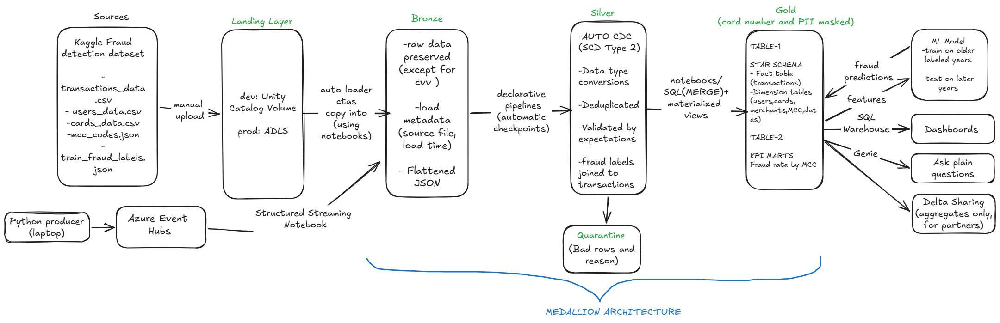

# Architecture

> Target architecture for the project. It is built incrementally in weekly releases; see the README status line for what exists today.

## Purpose
A lakehouse on Azure Databricks that turns raw card-transaction data into clean, governed tables for a bank's fraud team. It serves three uses: analysts exploring fraud patterns (dashboards, Genie), partners receiving aggregated statistics (Delta Sharing), and a baseline model that scores transactions for fraud risk.

Out of scope: real-time payment authorisation. The live stream demonstrates the streaming path but does not block payments.

## Data flow
**File path (batch):** source files are uploaded to a landing zone, loaded into bronze by notebooks, cleaned in silver by a declarative pipeline, and modelled in gold for analytics and the model.

**Live path (streaming):** a Python producer replays transactions as events into Azure Event Hubs; a Structured Streaming notebook writes them into bronze continuously.

## Layers and guarantees

| Layer | What it guarantees | Built with |
|---|---|---|
| Landing | Source files exactly as received; not queryable as tables | Unity Catalog volume (dev), ADLS (prod) |
| Bronze | Every source row as received, one table per source, with load metadata (source file, load time); JSON dictionaries reshaped into rows; **CVV never present** | Notebooks: Auto Loader, COPY INTO, CTAS |
| Silver | Correct data types, no duplicates, passed data quality expectations, fraud labels joined to transactions, full change history for users and cards (SCD Type 2) | Lakeflow Declarative Pipelines |
| Quarantine | Every row rejected by silver, with the rule it failed; nothing is silently dropped | Lakeflow Declarative Pipelines |
| Gold | Star schema (transaction fact table, user/card/merchant/MCC/date dimensions) and KPI marts; card numbers and PII masked for analysts | Notebooks/SQL (MERGE), materialized views |

## Batch and streaming
Static files load as full batch, growing files as incremental batch (Structured Streaming with the `availableNow` trigger), and only the Event Hubs feed runs as a continuous stream. Each source gets the freshness it needs without paying for idle compute. See [ADR-0004](adr/0004-batch-vs-streaming.md).

## Machine learning
The model reads features from gold, trains on older labeled years and is tested on later years, so evaluation reflects future data. Fraud predictions are written back to gold as a table.

## Environments

| | Dev | Prod |
|---|---|---|
| Platform | Databricks Free Edition | Azure Databricks (Premium) |
| Landing storage | Unity Catalog volume | Azure Data Lake Storage Gen2 |
| Runs as | Developer account | Service principal |
| Deployment | Databricks Asset Bundle, `dev` target | Same bundle, `prod` target |

Code moves from dev to prod through Git: pull requests to `main`, tests in GitHub Actions, and deployment with Databricks Asset Bundles.

## Security and governance
* All tables are governed by Unity Catalog; analysts read gold only, bronze is restricted to the pipeline and engineers.
* CVV is dropped during ingestion and never stored ([ADR-0005](adr/0005-drop-cvv-at-ingestion.md)).
* Card numbers and PII are masked with column masks; regional access uses row filters.
* Secrets (e.g. the Event Hubs connection string) live in Azure Key Vault; storage is accessed through a managed identity, with no keys in code.

## Key decisions
* [ADR-0001](adr/0001-table-format.md): Delta Lake as the table format
* [ADR-0002](adr/0002-managed-vs-external-tables.md): Unity Catalog managed tables
* [ADR-0003](adr/0003-ingestion-tool.md): ingestion tool per source
* [ADR-0004](adr/0004-batch-vs-streaming.md): batch vs streaming per source
* [ADR-0005](adr/0005-drop-cvv-at-ingestion.md): drop CVV at ingestion
* [ADR-0006](adr/0006-notebooks-vs-declarative-pipelines.md): notebooks for bronze and gold, declarative pipelines for silver

## Known limitations
* The raw cards file in the landing zone still contains CVV; mitigated by restricted access and deleting files after ingestion.
* Data is synthetic (Kaggle); fraud patterns may be simpler than real ones.
* The live stream is run for demonstration and stopped afterwards to control cost.
* COPY INTO is idempotent per file, not per row; silver deduplication covers this.